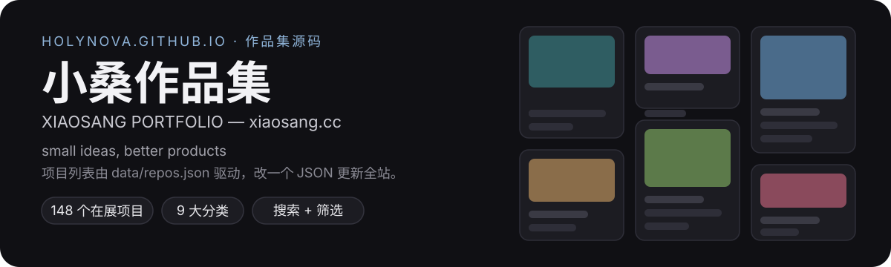
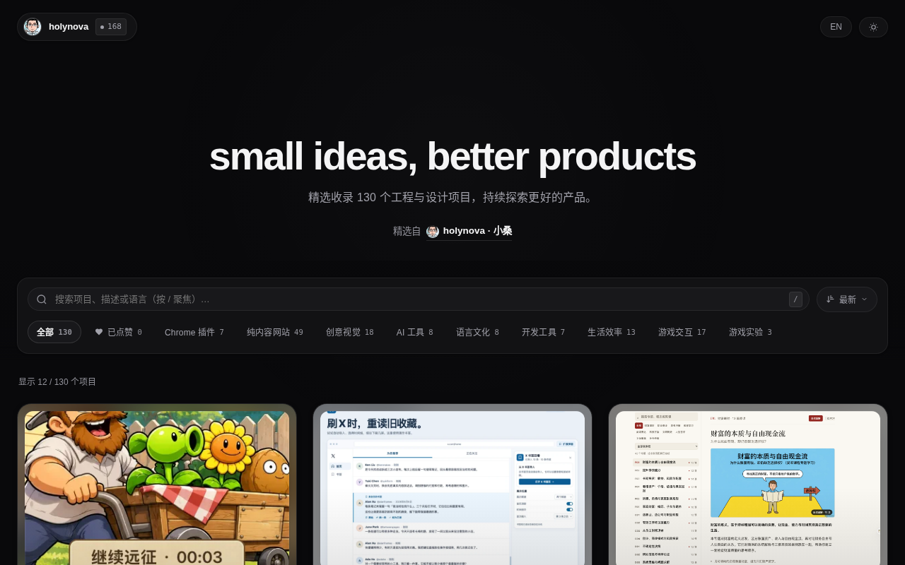

<p align="right"><a href="README.md">中文</a></p>

<p align="center">
  
</p>

<p align="center">
  <a href="https://xiaosang.cc/">▶ Visit Live</a>
  ·
  <a href="https://github.com/holynova/holynova.github.io">GitHub Repository</a>
</p>

Xiaosang Portfolio is the source of holynova's personal portfolio site [xiaosang.cc](https://xiaosang.cc/). The homepage shows 130 featured projects in a masonry grid across 9 categories, with search, category filters and three sort orders. The whole list is driven by `data/repos.json` — edit one JSON file to update the site. Zero build, plain HTML/CSS/JS.

## Screenshot

<p align="center">
  
</p>

## What It Is

- **Portfolio site**: holynova's small web projects — games, AI tools, creative visuals, dev tools, productivity, and more — each shown as a card with a screenshot, a description, and demo and repo links.
- **Data-driven**: `index.html` + `js/detail-app.js` render cards from `data/repos.json`; cards load progressively, 12 per batch, with automatic loading on desktop and a manual next-batch button on mobile.
- **On-site features**: search (press `/` to focus), 9 category filters, sorting (newest / stars / alphabetical), Chinese/English toggle, dark/light themes, likes and bookmarks; a minimal `classic.html` version is also included.
- **Counts** (measured from `data/repos.json`, 2026-11-17): 146 entries in total, 130 visible, 16 hidden.

| Category | Featured |
|---|---:|
| 纯内容网站 (Content Sites) | 49 |
| 游戏交互 (Games & Interactive) | 17 |
| 创意视觉 (Creative Visuals) | 18 |
| 生活效率 (Life & Productivity) | 13 |
| Chrome 插件 (Chrome Extensions) | 7 |
| AI 工具 (AI Tools) | 8 |
| 语言文化 (Language & Culture) | 8 |
| 开发工具 (Dev Tools) | 7 |
| 游戏实验 (Game Experiments) | 3 |

## Maintaining the List

`data/repos.json` is the single source of truth, shaped like this:

```json
{
  "lastUpdated": "2026-11-17",
  "totalRepos": 146,
  "categories": [
    { "name": { "zh": "游戏交互", "en": "Games" }, "repos": [ … ] }
  ]
}
```

Each project entry has: `name` (repo name), `title` (Chinese/English titles), `desc` (Chinese/English descriptions), `url` (GitHub repo), `homepage` (demo URL), `screenshot` (thumbnail path), `lang` (language), `pushed_at` / `commit_time` (for sorting), `hidden` (whether hidden). Optional fields include `cover` for a list thumbnail, `summary` for a short bilingual description, and `action` for the destination type.

**Adding a project**:

1. Append an entry to the right category's `repos` array in `data/repos.json`, with title, description, repo URL, and demo URL.
2. Drop a thumbnail in `screenshots/`, named `<name>.png` (a same-named `.webp` is recommended — cards prefer webp).
3. Bump `totalRepos` and `lastUpdated`.

**Hiding a project**: set that entry's `hidden` to `true` to unlist it from the site; the data stays.

## Run Locally

Zero build — just serve it statically:

```bash
python3 -m http.server 8080
# Open http://localhost:8080
```

`server.py` is the author's local dev helper (including a likes-sync API); everyday previews don't need it.

## Structure

```
index.html            Homepage (Detail visual edition)
classic.html          Minimal classic edition
data/repos.json       Project list, the single source of truth
data/screenshots-map.json  Screenshot mapping
js/detail-app.js      Homepage rendering: search / filters / sorting / progressive loading
js/main.js            Legacy homepage logic
css/                  Detail design-system styles
screenshots/         Project thumbnails (png + webp, 327 files)
server.py             Local dev helper service
pages/ algorithm/ animations/ css3/ framework/ layout/ plug_in/ tech/
                      Early built-in mini-projects and demos (legacy)
```

## Tech

- Zero build, zero framework: plain HTML/CSS/JS, runnable on any static server.
- Data-driven rendering + progressive loading (12 cards per batch); card thumbnails use `<picture>` with webp preferred.
- Responsive, mobile-first; dark/light themes, Chinese/English toggle.

## Contact

- Email: [holy_nova@126.com](mailto:holy_nova@126.com)
- GitHub: [holynova](https://github.com/holynova)
