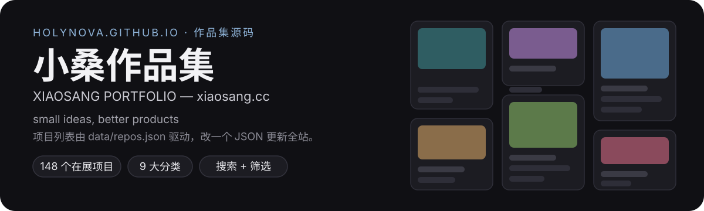
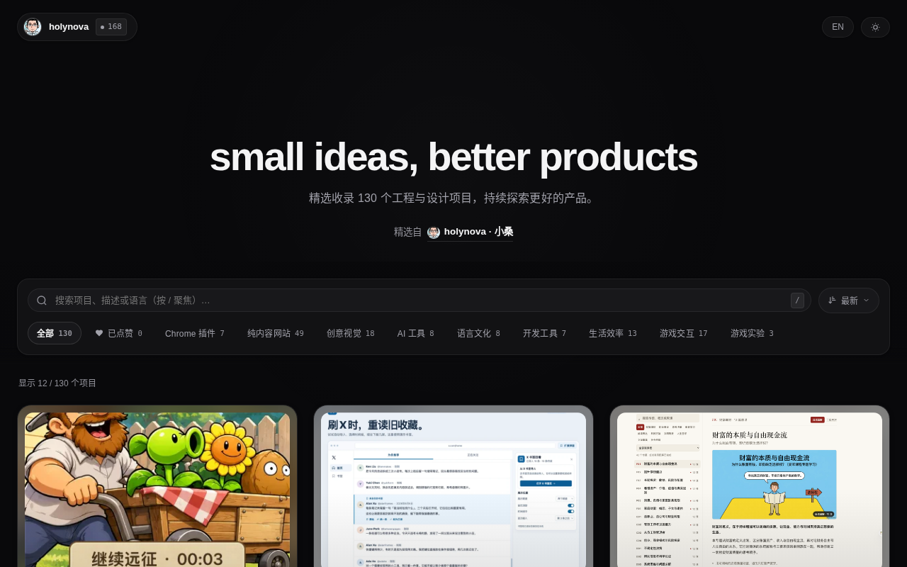

<p align="right"><a href="README.en.md">English</a></p>

<p align="center">
  
</p>

<p align="center">
  <a href="https://xiaosang.cc/">▶ 在线访问</a>
  ·
  <a href="https://github.com/holynova/holynova.github.io">GitHub 仓库</a>
</p>

小桑作品集是 holynova 个人作品集网站 [xiaosang.cc](https://xiaosang.cc/) 的源码仓库。首页以瀑布流卡片展示 130 个在展项目，分 9 大分类，支持搜索、分类筛选与三种排序；整个项目列表由 `data/repos.json` 驱动，改一个 JSON 文件就能更新全站。零构建，原生 HTML/CSS/JS。

## 截图

<p align="center">
  
</p>

## 这是什么

- **作品集站**：收录 holynova 的网页小项目——游戏、AI 工具、创意视觉、开发工具、生活效率等，每个项目一张卡片：截图、简介、Demo 与仓库链接。
- **数据驱动**：`index.html` + `js/detail-app.js` 读取 `data/repos.json` 渲染卡片；卡片渐进加载，每批 12 张，滚动到底自动续载。
- **站内功能**：搜索（按 `/` 聚焦）、9 个分类筛选、排序（最新 / Star / 字母）、中英双语切换、深浅主题切换、点赞收藏；另有极简版 `classic.html`。
- **数量**（以 `data/repos.json` 实测为准，2026-11-17）：共 146 条，130 条可见展示，16 条隐藏。

| 分类 | 在展 |
|---|---:|
| 纯内容网站 | 49 |
| 游戏交互 | 17 |
| 创意视觉 | 18 |
| 生活效率 | 13 |
| Chrome 插件 | 7 |
| AI 工具 | 8 |
| 语言文化 | 8 |
| 开发工具 | 7 |
| 游戏实验 | 3 |

## 项目列表怎么维护

`data/repos.json` 是唯一数据源，结构：

```json
{
  "lastUpdated": "2026-11-17",
  "totalRepos": 146,
  "categories": [
    { "name": { "zh": "游戏交互", "en": "Games" }, "repos": [ … ] }
  ]
}
```

每条项目包含：`name`（仓库名）、`title`（中英标题）、`desc`（中英简介）、`url`（GitHub 仓库）、`homepage`（Demo 地址）、`screenshot`（缩略图路径）、`lang`（语言）、`pushed_at` / `commit_time`（排序用）、`hidden`（是否隐藏）。

**新增一个项目**：

1. 在 `data/repos.json` 对应分类的 `repos` 里追加一条，填好标题、简介、仓库与 Demo 地址。
2. 截图放进 `screenshots/`，命名 `<name>.png`（建议同时提供同名 `.webp`，卡片优先用 webp）。
3. 更新 `totalRepos` 与 `lastUpdated`。

**隐藏项目**：把该条的 `hidden` 设为 `true` 即可下架展示，数据保留。

## 本地运行

零构建，起一个静态服务器即可：

```bash
python3 -m http.server 8080
# 打开 http://localhost:8080
```

`server.py` 是作者本地的开发辅助服务（含点赞同步接口），日常预览不需要它。

## 目录结构

```
index.html            首页（Detail 视觉版）
classic.html          极简经典版
data/repos.json       项目列表，唯一数据源
data/screenshots-map.json  截图映射
js/detail-app.js      首页渲染：搜索 / 筛选 / 排序 / 渐进加载
js/main.js            旧版首页逻辑
css/                  Detail 设计系统样式
screenshots/         项目缩略图（png + webp，327 张）
server.py             本地开发辅助服务
pages/ algorithm/ animations/ css3/ framework/ layout/ plug_in/ tech/
                      早期内置小项目与演示（历史遗留）
```

## 技术

- 零构建、零框架：原生 HTML/CSS/JS，可直接用静态服务器跑。
- 数据驱动渲染 + 渐进加载（每批 12 张卡），卡片缩略图 `<picture>` 优先 webp。
- 响应式，移动端优先；深浅双主题、中英双语。

## 联系

- 邮箱：[holy_nova@126.com](mailto:holy_nova@126.com)
- GitHub：[holynova](https://github.com/holynova)
